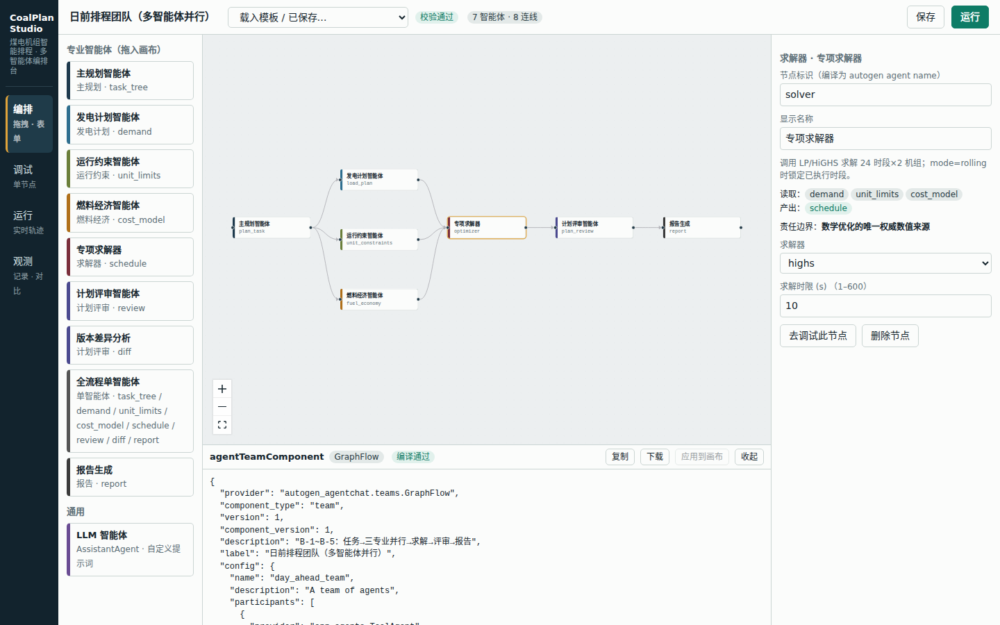

# CoalPlan Studio · 煤电机组智能排程多智能体协同决策系统

> 场景：两台常规燃煤机组（`B-U1` / `B-U2`）的**日前 24 时段发电计划**与**日内滚动修订**。
> 形态：可视化智能体构建器（表单 + 拖拽）→ 序列化为 **`agentTeamComponent`**（AutoGen 组件树）→ 后端加载并执行 → 前端负责编排、调试、运行、观测全流程。

所有机组参数与需求数据均为**演示用模拟数据**，不代表任何真实电厂。



---

## 0. 实测结果（本仓库真实运行输出，非预设曲线）

| 项目 | V1 日前排程 | V2 日内滚动重排（18:00–21:00 新目标） |
|---|---|---|
| 24 时燃料变动成本 | 7,562,160 元 | 7,687,120 元（相对 V1 +124,960 元，源于调度目标升高，不代表优劣） |
| 求解规模 | 144 变量 / 168 约束 | 42 变量 / 49 约束（仅重算 17–23 时） |
| 求解器用时 | 个位到数十毫秒（本机，随机器波动） | 同量级 |
| 约束校验 | 168/168 | 168/168 |
| 版本差异 | — | 差异时段 18–21 时，最大出力变动 110 MW，已执行时段（0–16 时）未改动 |

- 口头算例（B-3）：全厂 1000 MW 单时段，500/500 = 315,000 元/h，600/400 = 312,000 元/h，差 3,000 元/h（0.95%）。**仅为参考变动成本下的解释算例，不代表全天效果，不外推。**
- 在本演示数据下，爬坡约束在全部时段都有裕量，**没有成为紧约束**（需求相邻时段变化 ≤ 130 MW，而爬坡能力为 360/240 MW·h⁻¹）。若要演示紧爬坡，请调大需求波动或把「爬坡折减系数」调低（运行约束智能体的表单参数）。
- 未做“相对人工/Excel 的耗时对比”，文档与界面均不声称分钟级优势。

已验证：`pytest` 9 项通过；无头浏览器走完「编排 → 运行 V1 → 滚动重排 V2 → 差异 → 观测 → 调试」全流程，无控制台报错。
**未验证**：真实 LLM 调用路径（`OpenAIChatCompletionClient`，见 §10.4）、Docker 部署、OR-Tools / 天筹适配（仅留接口，见 §10.2）。

---

## 1. 设计原则

1. **数值只有一个权威来源**：出力、成本只来自 `backend/app/solver.py`（HiGHS LP）。智能体只做数据组织、校验、解释；报告模板的数字全部取自产出物，LLM 节点只复述、不生成数字。
2. **组件树是唯一事实来源**：画布上的图只是编辑态；真正被执行的是 `agentTeamComponent`（`team.dump_component()` 的 JSON）。可在界面里查看、下载、手改、再“应用到画布”。
3. **编排可校验**：每个专业工具声明 `requires / provides`（读取/产出的产出物），编译前静态检查上游是否齐备、是否成环，错误直接标注在节点上。
4. **全程留痕**：每个智能体的起止、工具调用参数、产出物、求解器调用与返回、完整事件流都持久化，可回放、可对比。
5. **安全默认**：用户提交的组件 JSON 只允许白名单内的 `provider`（见 §6.9）。

---

## 2. 架构

```
┌────────────────────────── 前端 (React + @xyflow/react, Vite) ──────────────────────────┐
│ 编排 Builder      调试 Debug         运行 Run              观测 Observe              │
│ 调色板/画布/表单   单节点/运行至此    SSE 实时轨迹+节点状态   运行列表/时间线/调用记录/对比 │
│        │ flow(编辑态)                    ▲ 事件流 (SSE)             ▲ 持久化记录         │
└────────┼─────────────────────────────────┼───────────────────────────┼───────────────────┘
         ▼ /api/compile · /api/decompile · /api/validate · /api/runs · /api/debug/node
┌──────────────────────────────── 后端 (FastAPI + AutoGen 0.7) ──────────────────────────┐
│ compiler.py   flow ⇄ agentTeamComponent；静态校验；provider 白名单；预置模板              │
│ runner.py     load_component → team.run_stream → 事件/产出物 → 落盘；V1 基线发布          │
│ agents.py     ToolAgent（自定义 autogen Component，包装专业工具）                          │
│ tools.py      专业工具注册表 + RunContext(黑板/事件总线)                                  │
│ solver.py     LP（scipy.linprog / HiGHS）+ 滚动优化 + 独立约束校验器                       │
│ scenario.py   模拟数据：机组、分段煤耗、V1 需求、V2 修订                                    │
└────────────────────────────────────────────────────────────────────────────────────────┘
```

**一次运行的数据流**：前端 flow → `/api/compile` → `GraphFlow.dump_component()` → `/api/runs` → `GraphFlow.load_component()` → 各 `ToolAgent.on_messages` 调用专业工具 → 工具往 `RunContext` 写产出物并发事件 → SSE 推到前端 → 结束后写 `data/runs/<id>.json`。

### 目录结构

```
coalplan-studio/
├─ backend/
│  ├─ app/{scenario,solver,tools,agents,compiler,runner,main}.py
│  ├─ tests/test_core.py          # 9 项测试
│  ├─ static/                     # 已构建的前端（npm run build 产物）
│  └─ requirements.txt
├─ frontend/src/{App,Builder,RunView,DebugView,Observe,Results,charts}.jsx · api.js · style.css
├─ examples/                      # 4 个模板的 flow 与 agentTeamComponent JSON
├─ docs/screens/                  # 截图
└─ start.sh
```

---

## 3. 与业务分镜的对应（B-1 ~ B-7）

| 分镜 | 在系统中怎么做 | 对应产出物 / 页面 |
|---|---|---|
| B-1 日前任务 | 运行页选「日前排程」→「启动智能排程」；主规划智能体解析任务并分派 | `task_tree`：任务卡（日期、24 点需求、2 机组、目标）+ 6 项任务 |
| B-2 专业协同 | 运行页「专业协同」卡 + 观测页时间线 | 负荷曲线 / 容量爬坡边界 / 煤耗函数 / 约束清单四张卡；三专业智能体在 GraphFlow 中**并行** |
| B-3 经济性与约束 | 同上第三、四张卡 | 分段煤耗表 + 口头算例（315,000 / 312,000 / 3,000 / 0.95%，标注“不外推”） |
| B-4 求解优化 | 「排程结果」页 | 逐时 MW、约束通过率、成本、求解时间；观测页有“求解器调用记录” |
| B-5 结果解释 | 「求解说明」页 | 功率平衡、爬坡校验、边际成本与边际机组、为何低成本机组多发。**不提供“与传统方案对比”按钮** |
| B-6 日内滚动修订 | 选「日内滚动重排」→「滚动重排」（模板：日内滚动修订团队） | V2 计划：灰底锁定 0–16 时、V1 虚线对照、「版本差异」页 |
| B-7 发布 | 「计划报告」页 | 《日前生产计划及日内修订报告》（Markdown，可下载） |

---

## 4. 快速开始

```bash
# 生产模式：后端托管已构建前端
./start.sh                       # → http://localhost:8000

# 开发模式
cd backend && pip install -r requirements.txt
python -m uvicorn app.main:app --reload --port 8000
cd frontend && npm install && npm run dev      # → http://localhost:5173（/api 代理到 8000）

# 重新构建前端并交给后端托管
cd frontend && npm run build && rm -rf ../backend/static && cp -r dist ../backend/static

# 测试
cd backend && python -m pytest -q tests
```

环境变量：`COALPLAN_DATA`（数据目录，默认 `backend/data`）、`LLM_API_KEY` / `OPENAI_API_KEY`（启用真实 LLM 节点，§10.4）。

**5 分钟上手**：打开页面 → 顶部载入「日前排程团队」→ 点节点看右侧表单 → 底部抽屉看 `agentTeamComponent` → 「运行」→ 看实时轨迹和结果 → 切到「日内滚动重排」，载入「日内滚动修订团队」后点「滚动重排」。

---

## 5. 核心概念

### 5.1 agentTeamComponent

AutoGen 的组件序列化格式（`provider / component_type / version / config`）。本系统的团队有两种：

| 编排方式 | provider | 用途 |
|---|---|---|
| 有向图 | `autogen_agentchat.teams.GraphFlow` | 多智能体：支持**并行（一个节点连多个下游）**与**汇聚（多个上游连一个节点，默认等全部上游完成）** |
| 轮询 | `autogen_agentchat.teams.RoundRobinGroupChat` | 单智能体（1 个参与者），或按横向位置顺序执行 |

团队 `config` 包含 `participants`（智能体组件列表）、`termination_condition`（`MaxMessageTermination`）、GraphFlow 另有 `graph.nodes.<name>.edges`。完整样例见 `examples/*.component.json`，节选：

```json
{
  "provider": "autogen_agentchat.teams.GraphFlow",
  "component_type": "team",
  "label": "日前排程团队（多智能体并行）",
  "config": {
    "participants": [
      { "provider": "app.agents.ToolAgent", "component_type": "agent", "label": "专项求解器",
        "config": { "name": "solver", "tool": "optimizer", "params": { "solver": "highs", "time_limit_s": 10 } } }
    ],
    "graph": { "nodes": { "planner": { "edges": [ { "target": "load_agent" }, { "target": "constraint_agent" }, { "target": "fuel_agent" } ] } } }
  }
}
```

### 5.2 两类节点

- **专业智能体 `ToolAgent`**（自定义 `Component[ToolAgentConfig]`，provider `app.agents.ToolAgent`）：配置只有 `name / tool / params`，运行时调用 `tools.py` 里注册的确定性专业工具。
- **LLM 智能体**：标准 `AssistantAgent` + 模型客户端 + 系统提示词。只做解释。

### 5.3 产出物黑板与依赖

| 工具（智能体） | requires | provides |
|---|---|---|
| `plan_task` 主规划 | — | `task_tree` |
| `load_plan` 发电计划 | — | `demand` |
| `unit_constraints` 运行约束 | — | `unit_limits` |
| `fuel_economy` 燃料经济 | — | `cost_model` |
| `optimizer` 专项求解器 | demand, unit_limits, cost_model | `schedule` |
| `plan_review` 计划评审 | schedule, demand, unit_limits | `review` |
| `plan_diff` 版本差异 | schedule（+ V1 基线） | `diff` |
| `report` 报告生成 | schedule, review, demand, cost_model, unit_limits | `report` |
| `pipeline_all` 全流程单智能体 | — | 以上全部 |

- **严格模式**（正式运行）：缺上游产出物即报错；编译前的静态校验会先拦住。
- **调试模式**（单节点调试）：缺什么就用默认参数惰性补全，并在事件里写明。

---

## 6. 实现步骤（按开发顺序）

### Step 1 场景与数据 —— `scenario.py`
- 两台机组：额定 600 MW；最小稳定出力 240 / 300 MW；爬坡 6 / 4 MW/min；初始 450 MW。
- **分段煤耗成本**（凸，边际成本递增），用于正式模型：
  - B-U1：240–400 @288、400–520 @304、520–600 @326 元/MWh；B-U2：300–420 @318、420–520 @332、520–600 @348。
  - “参考变动成本 300 / 330 元/MWh”仅用于 B-3 口头算例，不进入求解。
- 24 点需求 V1（900–1100 MW）；`REVISION` 把 18–21 时改为 1160/1190/1150/1090 MW，17:00 下发。
- 两台机组均在线，**不做启停优化**，无生物质。

### Step 2 求解器 —— `solver.py`
连续出力分配，LP（HiGHS）。模型见 §7。要点：
- 凸分段成本 ⇒ 不需要二进制变量，也不需要 MILP；若引入启停才需要 MILP。
- 返回 **功率平衡的影子价格**作为逐时系统边际成本，用于“求解说明”。
- `verify()` 是**独立校验器**：不读求解器内部变量，只拿最终出力重新逐条检查（平衡、下限、上限、爬坡），算通过率。
- 滚动优化 `start=17, locked=...`：只对 17–23 时建变量，起点取 16 时已执行出力；已执行时段原样拼回。
- 不可行时返回 `status=infeasible`（有测试覆盖），不会给出看似合理的假方案。

### Step 3 专业工具注册表 —— `tools.py`
- `Tool(key,label,role,color,params,requires,provides,fn)`；`params` 描述表单字段（number/string/boolean/select，含范围），前端据此**自动渲染表单**，后端据此校验。
- `RunContext`：黑板（`artifacts`）+ 事件总线（`emit`）+ 数据版本/模式 + `baseline_provider`。
- 工具间只通过产出物通信。`optimizer` 在 `mode=rolling` 时向 `baseline_provider` 取 V1 基线。
- `plan_review` 生成确定性的“求解说明”（用数据判断哪台机组已达上限、爬坡是否取等、边际机组是谁）；`plan_diff` 做确定性差分；`report` 只做模板拼装。

### Step 4 自定义 AutoGen 组件 —— `agents.py`
- `ToolAgent(BaseChatAgent, Component[ToolAgentConfig])`，`component_provider_override="app.agents.ToolAgent"`，实现 `_to_config/_from_config`，因此 `dump_component()` / `load_component()` 都能往返。
- `on_messages` 内：发 `agent_start` → 同步调用工具 → 发 `tool_call`/`agent_end` → 返回 `TextMessage`。
- 当前 `RunContext` 用 `ContextVar` 传递（并留有全局回退，见 §11）。

### Step 5 编排编译器与校验 —— `compiler.py`
- `compile_flow(flow)`：用 `DiGraphBuilder` 构建 `GraphFlow`（或 `RoundRobinGroupChat`）→ `dump_component()` → 补上中文 `label`。直接用 AutoGen 自己序列化，保证产物就是合法组件。
- `decompile(component)`：组件 → flow（节点、边、自动分层布局），用于“从 JSON 应用到画布”。
- `validate(flow)`：标识符合法与唯一、参数范围、LLM 提示词非空、**DAG 无环**、**requires 由祖先 provides 满足**、孤立节点提示、缺少求解器提示。
- `templates()`：4 个预置团队（日前 / 日内滚动 / 单智能体基线 / 带 LLM 解说）。
- `to_runnable()`：无 LLM 密钥时，把 OpenAI 客户端换成离线回放客户端（深拷贝，不改存档）。

### Step 6 运行服务 —— `runner.py`
- `execute()`：新建 `RunContext` → `load_component` → `team.run_stream`，把消息与 TaskResult 转成事件；异常转 `error` 事件并标记失败。
- **SSE**：`/api/runs/{id}/stream` 轮询 `ctx.events`，支持晚加入者从头回放；已结束的运行直接从磁盘回放。
- **落盘**：`data/runs/<id>.json`（事件、产出物、所用 component、摘要、组件摘要 digest）。
- **V1 基线发布**：严格模式下 V1 日前运行成功后写 `published_V1.json`，滚动重排以它为基线；没有则用默认参数即时求解 V1。
- 串行执行锁 `_lock`（演示环境，保证全局回退上下文安全）。

### Step 7 API —— `main.py`
见 §9。同时托管 `backend/static` 作为单页应用。

### Step 8 前端
| 页面 | 实现 |
|---|---|
| **编排** | 左：按角色着色的调色板（HTML5 拖拽）；中：React Flow 画布（拖线连接、Delete 删除、状态着色）；右：属性面板（按工具 `params` 自动生成表单；无选中时是团队设置/校验列表）；底：`agentTeamComponent` 抽屉（实时编译、复制、下载、可编辑并“应用到画布”）。编辑后 300 ms 防抖自动校验+编译。 |
| **调试** | 选节点 →「仅运行此节点（自动补全上游）」或「运行至此节点（含全部上游，严格）」；看输入参数、事件、产出物 JSON。 |
| **运行** | 数据版本/模式切换 + 启动；迷你画布实时显示节点“运行中/完成/失败”；右侧 6 个结果页签随产出物到达逐个亮起（任务卡、专业协同、排程结果、求解说明、版本差异、计划报告）。 |
| **观测** | 运行列表（可勾选两条对比成本/耗时/通过率/组件摘要）；智能体时间线；工具与求解器调用记录；完整事件；本次使用的 component。 |


### Step 9 安全
`compiler.ALLOWED_PROVIDERS` 白名单：`/api/runs` 收到的 component 与 `runner.execute` 内各检查一次。否则 `load_component` 会按 `provider` 路径导入任意类（相当于任意代码执行）。测试 `test_provider_allowlist_blocks_arbitrary_import` 覆盖。

### Step 10 测试
`backend/tests/test_core.py`：求解可行性与平衡；不劣于均分；滚动锁定；爬坡不可行如实报告；口头算例数值；4 个模板编译-反编译往返；校验器抓缺上游/环；provider 白名单；端到端日前→滚动（差异时段恰为 18–21、已执行时段未改动、通过率 100%）。

---

## 7. 数学模型

对机组 *u*、时段 *t*、分段 *s*（长度 L<sub>us</sub>，边际成本 c<sub>us</sub>）：

- 变量：x<sub>uts</sub> ∈ [0, L<sub>us</sub>]；出力 P<sub>ut</sub> = Pmin<sub>u</sub> + Σ<sub>s</sub> x<sub>uts</sub>
- 目标：min Σ<sub>u,t,s</sub> (c<sub>us</sub>·煤价系数 + 辅机成本)·x<sub>uts</sub>（Pmin 处的基础成本为常数，不影响最优解，仅计入总成本）
- 功率平衡：Σ<sub>u</sub> P<sub>ut</sub> = D<sub>t</sub>
- 容量：P<sub>ut</sub> ≤ Avail<sub>ut</sub>（检修窗口、下限由变量定义保证）
- 爬坡：|P<sub>ut</sub> − P<sub>u,t−1</sub>| ≤ 爬坡 MW/min × 60 × 折减系数；首时段与初始出力（滚动时与上一已执行时点）相连
- 滚动：t < start 的出力固定为已执行值，仅 t ≥ start 建变量

**粒度说明**：模型按整点（小时）建模，爬坡限制折算为每小时最大变化量，不刻画小时内的轨迹。

---

## 8. 在画布里做的事（用户操作说明）

1. **拖**：从左侧把专业智能体拖进画布，节点标识自动生成（重复自动加后缀）。
2. **连**：从节点右侧圆点拖到另一节点左侧。并行 = 一个节点连多个下游；汇聚 = 多个上游连同一个下游。
3. **填**：点节点，右侧改显示名与参数；LLM 节点填系统提示词。
4. **看**：节点右上角红字 = 校验错误；底部抽屉看实时编译出的组件 JSON。
5. **跑**：顶部「运行」；或到「调试」页单独跑某节点。
6. **存**：「保存」写入 `data/workspaces/`，顶部下拉可再载入。
7. **单智能体**：载入「单智能体基线」模板，或在团队设置里选 RoundRobin 并只放 1 个节点。

---

## 9. API 参考

| 方法 路径 | 说明 |
|---|---|
| `GET /api/tools` | 专业工具目录（表单 schema、requires/provides、责任边界） |
| `GET /api/scenario` | 机组、V1/V2 需求、修订信息 |
| `GET /api/templates` | 预置团队（flow） |
| `POST /api/validate` `{flow}` | 返回 issues（error / warn） |
| `POST /api/compile` `{flow}` | 校验通过则返回 `component` |
| `POST /api/decompile` `{component, positions?}` | 组件 → flow |
| `POST /api/runs` `{flow \| component, version, mode}` | 启动严格运行，返回 `run_id`；校验失败 / provider 越权 → 422 |
| `POST /api/debug/node` `{flow,node_id,upto,version,mode}` | 单节点调试 / 运行至此节点 |
| `GET /api/runs` · `GET /api/runs/{id}` | 记录列表 / 详情（事件、产出物、component） |
| `GET /api/runs/{id}/stream` | SSE 事件流（`event: end` 结束） |
| `GET /api/runs/{id}/report.md` | 下载报告 |
| `GET/POST/DELETE /api/workspaces[/{id}]` | 保存的团队 |
| `DELETE /api/baseline` | 清除已发布的 V1 基线 |

`version` ∈ {`V1`,`V2`}；`mode` ∈ {`day_ahead`,`rolling`}。

---

## 10. 扩展指南

### 10.1 新增一个专业工具
在 `tools.py` 写 `t_xxx(ctx, params) -> str`（用 `ctx.require(...)` 读上游、`ctx.put(key, value)` 写产出物），在 `TOOLS` 里注册 `Tool(...)`，声明 `params/requires/provides`。前端调色板、表单、校验、调试会自动出现，无需改前端。若产出物需要专属展示，在 `Results.jsx` 增加一个卡片。

### 10.2 更换求解器（OR-Tools / 天筹）
保持 `solve(units, demand, limits, ...) -> dict` 的返回结构不变（`output / cost_total / marginal_price / status / solve_seconds`），在 `solver.py` 增加实现，并在 `optimizer` 工具 `solver` 参数的 `options` 里登记即可。当前**仅实现 HiGHS**；OR-Tools/天筹适配未做，也未验证。

### 10.3 接入真实数据
替换 `scenario.py`：需求来自调度/交易系统，机组边界来自设备台账与检修计划（`MAINTENANCE`），分段煤耗来自试验曲线与煤价。`DEMAND`/`REVISION` 做成接口读取即可。

### 10.4 启用真实 LLM 节点
`pip install "autogen-ext[openai]"`，设置 `OPENAI_API_KEY`（或 `LLM_API_KEY`），LLM 节点即调用 `OpenAIChatCompletionClient`；未设置时返回固定离线文案（节点会明说）。该路径**本仓库未实际调用验证**。LLM 只应解释，不应产生数值；若需强约束，可在其后加一个“数字一致性核对”工具。

### 10.5 引入机组启停
需要 MILP：加启停二进制变量、最小开停机时间、启动成本，仍用 HiGHS（`scipy.optimize.milp`）。当前演示明确不含启停。

---

## 11. 已知限制（请勿过度解读）

- 数据均为模拟；成本、煤耗曲线仅用于演示流程。
- 整点粒度；未建模小时内爬坡轨迹、备用/调频、网络约束、碳/排放成本。
- 滚动修订的“已执行时段”按固定 17:00 下发时点处理；V2 是预置数据版本。
- 工具同步执行，GraphFlow 的“并行”体现在编排语义上，毫秒级任务不会有真实并发收益。
- 运行用串行锁；`RunContext` 以 `ContextVar` 传递，若在你的 autogen 版本中未传播到 runtime 任务，会使用全局回退（因此需保持串行）。
- 无登录鉴权、无多人协作、无版本历史；`data/` 为文件存储。
- 仅支持 DAG；不支持条件边与循环。
- 报告为 Markdown；Word/PDF 导出未实现。
- 项目锁定 `autogen-agentchat 0.7.x`；AutoGen 组件 schema 在大版本间可能变化。

---

## 12. 常见问题

- **运行时报“缺少上游产出物”**：到编排页看节点红字，补连线（如求解器必须有发电计划、运行约束、燃料经济三个上游）。
- **滚动重排报“需要 V1 基线”**：先跑一次日前排程，或直接重试（系统会自动即时求解 V1 基线）。
- **想重置基线/记录**：`DELETE /api/baseline`；删除 `backend/data/`。
- **节点不显示 / 画布空白**：确认容器有高度（已在 CSS 处理）；刷新后点画布左下角“适应视图”。
- **手改 JSON 后应用失败**：provider 必须在白名单内，且 `ToolAgent.tool` 必须是已注册工具。
